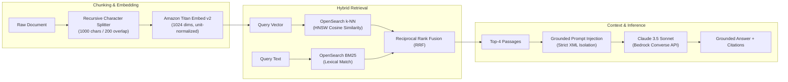
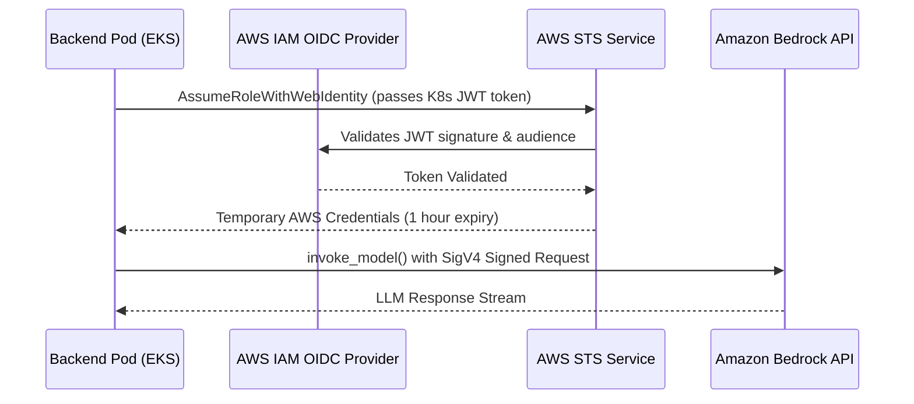
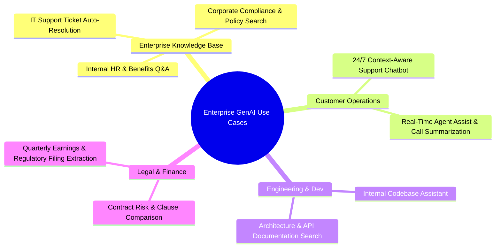

# ☁️🤖 AWS + GenAI – Complete Production Architecture Guide

> **Enterprise-Ready Generative AI & Retrieval-Augmented Generation (RAG) Platform**  
> *Built with Amazon Bedrock, Amazon OpenSearch Serverless, Amazon EKS, AWS Lambda, Amazon S3, Terraform, Helm, and CloudWatch.*

---

## 📑 Table of Contents

1. [Executive Summary & High-Level Architecture](#1-executive-summary--high-level-architecture)
2. [End-to-End Traffic & Data Lifecycles](#2-end-to-end-traffic--data-lifecycles)
   - [2.1 Synchronous User Query Flow (Sub-Second Latency)](#21-synchronous-user-query-flow-sub-second-latency)
   - [2.2 Asynchronous Document Ingestion Flow](#22-asynchronous-document-ingestion-flow)
   - [2.3 Production CI/CD & Deployment Flow](#23-production-cicd--deployment-flow)
3. [Networking & Perimeter Security (VPC & Ingress)](#3-networking--perimeter-security-vpc--ingress)
   - [3.1 Multi-AZ Subnet Topography](#31-multi-az-subnet-topography)
   - [3.2 Route 53, CloudFront & AWS WAF](#32-route-53-cloudfront--aws-waf)
   - [3.3 AWS PrivateLink & VPC Endpoints](#33-aws-privatelink--vpc-endpoints)
4. [Container Orchestration & Compute (Amazon EKS)](#4-container-orchestration--compute-amazon-eks)
   - [4.1 Cluster Architecture & Node Topology](#41-cluster-architecture--node-topology)
   - [4.2 Pod Lifecycle, Requests, Limits & Security Contexts](#42-pod-lifecycle-requests-limits--security-contexts)
   - [4.3 Horizontal Pod Autoscaling (HPA) & Karpenter Autoscaling](#43-horizontal-pod-autoscaling-hpa--karpenter-autoscaling)
5. [Application Stack: FastAPI Backend & Next.js Frontend](#5-application-stack-fastapi-backend--nextjs-frontend)
   - [5.1 FastAPI Microservice Design & Async Lifecycles](#51-fastapi-microservice-design--async-lifecycles)
   - [5.2 Next.js 14 Standalone Frontend & Streaming UI](#52-nextjs-14-standalone-frontend--streaming-ui)
   - [5.3 Streaming Protocols: Server-Sent Events (SSE) vs WebSockets](#53-streaming-protocols-server-sent-events-sse-vs-websockets)
6. [Complete Production RAG Architecture](#6-complete-production-rag-architecture)
   - [6.1 Text Splitting, Chunking Strategies & Overlap](#61-text-splitting-chunking-strategies--overlap)
   - [6.2 Vector Embeddings with Amazon Titan v2](#62-vector-embeddings-with-amazon-titan-v2)
   - [6.3 Amazon OpenSearch Serverless (AOSS) Vector Store](#63-amazon-opensearch-serverless-aoss-vector-store)
   - [6.4 Hybrid Retrieval: Combining Dense k-NN & Sparse BM25](#64-hybrid-retrieval-combining-dense-k-nn--sparse-bm25)
   - [6.5 Context Augmentation, Reranking & Prompt Engineering](#65-context-augmentation-reranking--prompt-engineering)
   - [6.6 LLM Inference with Amazon Bedrock Converse API](#66-llm-inference-with-amazon-bedrock-converse-api)
7. [Automated Document Ingestion Pipeline](#7-automated-document-ingestion-pipeline)
   - [7.1 S3 Event Notifications & EventBridge](#71-s3-event-notifications--eventbridge)
   - [7.2 AWS Lambda Parser & Embedder](#72-aws-lambda-parser--embedder)
   - [7.3 Dead-Letter Queues (DLQ) & Error Handling](#73-dead-letter-queues-dlq--error-handling)
8. [Infrastructure as Code (IaC) with Terraform](#8-infrastructure-as-code-iac-with-terraform)
   - [8.1 Modular Directory Structure](#81-modular-directory-structure)
   - [8.2 Remote State Locking with S3 & DynamoDB](#82-remote-state-locking-with-s3--dynamodb)
   - [8.3 Core Terraform Modules](#83-core-terraform-modules)
9. [Kubernetes Packaging & Deployment with Helm](#9-kubernetes-packaging--deployment-with-helm)
   - [9.1 Helm Chart Hierarchy & Values Architecture](#91-helm-chart-hierarchy--values-architecture)
   - [9.2 Rolling Update Strategies & Zero Downtime](#92-rolling-update-strategies--zero-downtime)
10. [CI/CD Pipeline with GitHub Actions](#10-cicd-pipeline-with-github-actions)
    - [10.1 Keyless Authentication via AWS IAM OIDC](#101-keyless-authentication-via-aws-iam-oidc)
    - [10.2 Vulnerability Scanning with Trivy](#102-vulnerability-scanning-with-trivy)
    - [10.3 ECR Image Tagging & Helm CD](#103-ecr-image-tagging--helm-cd)
11. [Enterprise Security, IAM & Governance](#11-enterprise-security-iam--governance)
    - [11.1 IAM Roles for Service Accounts (IRSA)](#111-iam-roles-for-service-accounts-irsa)
    - [11.2 AWS Secrets Manager & External Secrets Operator](#112-aws-secrets-manager--external-secrets-operator)
    - [11.3 Amazon Bedrock Guardrails (Safety, PII, Injection Defense)](#113-amazon-bedrock-guardrails-safety-pii-injection-defense)
12. [Observability, Monitoring & Distributed Tracing](#12-observability-monitoring--distributed-tracing)
    - [12.1 Amazon CloudWatch Logs & Embedded Metric Format (EMF)](#121-amazon-cloudwatch-logs--embedded-metric-format-emf)
    - [12.2 AWS X-Ray End-to-End Distributed Tracing](#122-aws-x-ray-end-to-end-distributed-tracing)
    - [12.3 CloudWatch Alarms & SNS Alerting Matrix](#123-cloudwatch-alarms--sns-alerting-matrix)
13. [Multi-Environment Architecture (Dev / Staging / Prod)](#13-multi-environment-architecture-dev--staging--prod)
14. [Cost Optimization & Sizing Playbook](#14-cost-optimization--sizing-playbook)
15. [Real-World Enterprise GenAI Use Cases](#15-real-world-enterprise-genai-use-cases)
16. [Interview Masterclass: System Design Q&A](#16-interview-masterclass-system-design-qa)

---

## 1. Executive Summary & High-Level Architecture

The AWS + GenAI Production Architecture is engineered to provide enterprise organizations with a scalable, secure, highly available (99.95% uptime SLA), and hallucination-resistant platform for generative AI applications.

### Architectural Diagram

```mermaid
flowchart TD
    subgraph Edge["Perimeter & Edge Tier"]
        Client(["Client Apps\n(Web / Mobile / Internal APIs)"])
        R53["Amazon Route 53 (DNS)"]
        WAF["AWS WAF (Layer 7 Defense)"]
        CF["Amazon CloudFront (Edge CDN)"]
        ALB["Application Load Balancer (ALB)"]
    end

    subgraph AWSVPC["AWS VPC (10.0.0.0/16 Multi-AZ)"]
        subgraph PublicSubnets["Public Subnets (3x AZ)"]
            NAT["NAT Gateways (EIP)"]
            ALB_Internal["ALB Ingress Listeners"]
        end

        subgraph PrivateSubnets["Private Subnets (3x AZ - Compute)"]
            subgraph EKSCluster["Amazon EKS Cluster (v1.30)"]
                FrontendPod["Frontend Pods (Next.js)"]
                BackendPod["Backend Pods (FastAPI)"]
                RAGService["LangChain RAG Engine"]
                HPAController["Horizontal Pod Autoscaler (HPA)"]
            end
            VPCEndpoints["VPC Endpoints (PrivateLink)\n(Bedrock, S3, Secrets Manager, X-Ray)"]
        end

        subgraph DataSubnets["Isolated Data Subnets"]
            AOSS[("OpenSearch Serverless\n(Vector Collection - HNSW)")]
            RDS[("Amazon Aurora Serverless v2\n(PostgreSQL - App Metadata)")]
        end
    end

    subgraph AWSManagedGenAI["AWS Managed GenAI Services"]
        Titan["Amazon Titan Embeddings v2\n(amazon.titan-embed-text-v2:0)"]
        Claude["Anthropic Claude 3.5 Sonnet\n(via Bedrock ConverseStream)"]
        Guardrails["Bedrock Guardrails\n(PII Masking & Injection Filter)"]
    end

    subgraph IngestionSystem["Automated Document Ingestion"]
        S3Bucket[("Amazon S3 Raw Bucket\n(PDF, Markdown, TXT)")]
        LambdaIngest["AWS Lambda Chunking & Embedder\n(Python 3.11)"]
        DLQ["Amazon SQS Dead-Letter Queue"]
    end

    subgraph GovernanceObservability["Security, Governance & Observability"]
        CW["Amazon CloudWatch\n(Logs, Metrics, Alarms)"]
        XRay["AWS X-Ray (Tracing)"]
        KMS["AWS KMS (KMS-CMK)"]
        SecretsMgr["AWS Secrets Manager"]
        IRSA["IAM Roles for Service Accounts"]
        SNS["Amazon SNS Alerting"]
    end

    Client --> R53 --> CF --> WAF --> ALB
    ALB -->|/* /api/v1| FrontendPod
    FrontendPod --> BackendPod
    BackendPod --> RAGService

    RAGService -->|1. Generate Vector| Titan
    RAGService -->|2. k-NN / Hybrid Search| AOSS
    RAGService -->|3. Validate Context| Guardrails
    RAGService -->|4. Augmented Context| Claude
    Claude -->|5. Stream Tokens (SSE)| BackendPod
    BackendPod -->|6. Render Stream| FrontendPod

    S3Bucket -->|ObjectCreated Notification| LambdaIngest
    LambdaIngest -->|Embed Chunks| Titan
    LambdaIngest -->|Store Vectors| AOSS
    LambdaIngest -.->|Failed Records| DLQ

    EKSCluster -.-> VPCEndpoints
    EKSCluster -.-> CW
    EKSCluster -.-> XRay
    EKSCluster -.-> IRSA
    CW --> SNS
```

---

## 2. End-to-End Traffic & Data Lifecycles

### 2.1 Synchronous User Query Flow (Sub-Second Latency)

```
[User Browser]
      │ 1. HTTPS POST /api/v1/chat (JSON payload)
      ▼
[Amazon Route 53] ──> [Amazon CloudFront + AWS WAF]
      │ 2. Edge caching static assets, inspects TLS 1.3 & SQLi/XSS/Prompt attack tokens
      ▼
[Application Load Balancer (ALB)]
      │ 3. Forward to Target Group on EKS Worker Node (NodePort / Pod IP via AWS VPC CNI)
      ▼
[EKS Pod: FastAPI Backend]
      │ 4. Extracts conversation history and question
      ▼
[Amazon Bedrock Runtime: Titan Embeddings v2]
      │ 5. Encodes query into 1024-dimensional normalized vector (Latency: ~25ms)
      ▼
[Amazon OpenSearch Serverless (AOSS)]
      │ 6. Hybrid search: BM25 keyword matching (boost: 0.3) + k-NN vector cosine similarity (boost: 0.7)
      │ 7. Returns top-k=4 semantic document chunks with metadata and source paths
      ▼
[Amazon Bedrock Guardrails]
      │ 8. Sanitizes retrieved context against prompt leakage, PII, and banned topics
      ▼
[Amazon Bedrock Runtime: Anthropic Claude 3.5 Sonnet]
      │ 9. Dispatches ConverseStream request with system grounding instructions and retrieved passages
      ▼
[FastAPI Backend Streaming Engine]
      │ 10. Transforms chunk deltas into Server-Sent Events (SSE) `data: {token}`
      ▼
[Next.js Frontend Client]
      │ 11. Real-time markdown rendering with source citation cards (< 600ms Time-To-First-Token)
```

---

### 2.2 Asynchronous Document Ingestion Flow

```
[Enterprise S3 Bucket: genai-knowledge-docs-prod]
      │ 1. New document uploaded (e.g., Q3_Financial_Report.pdf)
      ▼
[S3 Event Notification / Amazon EventBridge]
      │ 2. Filters suffix (.pdf, .txt, .md, .docx) -> triggers Lambda
      ▼
[AWS Lambda Ingestion Function]
      │ 3. Streams document into memory buffer via boto3 (Zero disk write)
      │ 4. PDF text extracted via streaming parser (PyPDF / pdfplumber)
      │ 5. Recursive Character Text Splitting:
      │    - chunk_size = 1000 characters
      │    - chunk_overlap = 200 characters
      │    - separators = ["\n\n", "\n", ". ", " ", ""]
      ▼
[Amazon Bedrock Titan Embeddings v2]
      │ 6. Batch generates embeddings in parallel micro-batches of 16 chunks
      ▼
[Amazon OpenSearch Serverless (AOSS)]
      │ 7. Bulk index API writes vector + content + doc_id + checksum + metadata
      │ 8. Index refresh makes chunks instantly retrievable for RAG
      ▼ (On Failure)
[Amazon SQS Dead-Letter Queue]
      │ 9. Unprocessable documents captured with error stack trace for replay
```

---

### 2.3 Production CI/CD & Deployment Flow

```
[Developer Git Push to main]
      │
      ▼
[GitHub Actions CI/CD Pipeline]
      │ 1. Automated Testing (pytest, unit tests, mock Bedrock & OpenSearch calls)
      │ 2. Security Vulnerability Scan: Trivy scans Dockerfiles and base image vulnerabilities
      │ 3. Keyless AWS Authentication: GitHub Actions assumes IAM Role via OpenID Connect (OIDC)
      │ 4. Docker Buildx: Multi-arch container builds for FastAPI and Next.js
      │ 5. Amazon ECR: Pushes immutable image tags (`sha-<commit_id>`)
      │ 6. Helm Upgrade: Deploys release `genai-app` to EKS namespace `genai`
      │ 7. Kubernetes Rolling Update: Starts new pods, verifies `/ready` and `/health` probes
      │ 8. Automated Smoke Test: Hits synthetic health endpoints through CloudFront
```

---

## 3. Networking & Perimeter Security (VPC & Ingress)

### 3.1 Multi-AZ Subnet Topography

The platform is deployed inside a dedicated **AWS VPC (10.0.0.0/16)** distributed across 3 distinct Availability Zones (AZ-a, AZ-b, AZ-c) to prevent single-datacenter failure.

| Subnet Tier | CIDR Block | Route Table Destination | Public Exposure | Resource Placement |
| :--- | :--- | :--- | :--- | :--- |
| **Public Subnets** | `10.0.0.0/20`, `10.0.16.0/20`, `10.0.32.0/20` | `0.0.0.0/0` $\rightarrow$ Internet Gateway (IGW) | Direct Internet | Public Application Load Balancer (ALB), NAT Gateways |
| **Private Subnets** | `10.0.48.0/20`, `10.0.64.0/20`, `10.0.80.0/20` | `0.0.0.0/0` $\rightarrow$ NAT Gateway / VPC Endpoints | No (Egress only) | EKS Managed Worker Nodes, CoreDNS, Ingestion Lambda |
| **Data / Isolated Subnets** | `10.0.96.0/20`, `10.0.112.0/20`, `10.0.128.0/20` | Local VPC Only (No internet route) | Completely Isolated | Aurora PostgreSQL Database, OpenSearch VPC Endpoints |

### 3.2 Route 53, CloudFront & AWS WAF

1. **Amazon Route 53**: Geo-proximity routing with active health-checks pointing an Alias record to Amazon CloudFront.
2. **Amazon CloudFront**:
   - TLS 1.3 termination with SNI support.
   - HTTP/2 and HTTP/3 support for streaming response reduction.
   - Origin Request Policies pass dynamic `/api/v1/*` requests directly to ALB without caching, while caching static frontend assets at 450+ Points of Presence (PoPs).
3. **AWS WAF (Web Application Firewall)**:
   - AWS Managed Rules: `AWSManagedRulesCommonRuleSet`, `AWSManagedRulesKnownBadInputsRuleSet`, and `AWSManagedRulesAmazonIpReputationList`.
   - Rate limiting: Max 1,000 requests per 5-minute rolling window per IP.
   - Custom Regex rules blocking prompt injection signatures (e.g., `"ignore previous instructions"`, `"system override"`).

### 3.3 AWS PrivateLink & VPC Endpoints

To prevent sensitive enterprise document data from traversing the public internet, VPC Endpoints are configured inside the private subnets:

- **S3 Gateway Endpoint**: Routing table entry that routes S3 API traffic directly to S3 over AWS internal fibers with **zero data transfer fee**.
- **Bedrock Interface Endpoint (`com.amazonaws.region.bedrock-runtime`)**: PrivateLink elastic network interfaces (ENIs) inside private subnets ensuring LLM inference never exits the AWS private backbone.
- **Secrets Manager Endpoint (`com.amazonaws.region.secretsmanager`)**: Guarantees secret retrieval during pod startup remains fully internal.

---

## 4. Container Orchestration & Compute (Amazon EKS)

### 4.1 Cluster Architecture & Node Topology

The workload runs on **Amazon Elastic Kubernetes Service (EKS)** running Kubernetes version **1.30**.
- **Control Plane**: Fully managed by AWS across multiple AZs with automated etcd backups and control plane logging enabled (`api`, `audit`, `authenticator`, `controllerManager`, `scheduler`).
- **Data Plane (Managed Node Groups)**:
  - Instance Type: `m6i.xlarge` (4 vCPU, 16 GiB RAM) using AWS Nitro System for consistent compute and memory bandwidth.
  - OS: Amazon Linux 2023 with containerd runtime.
  - Capacity: Spread across 3 Availability Zones with topology spread constraints:

```yaml
topologySpreadConstraints:
  - maxSkew: 1
    topologyKey: topology.kubernetes.io/zone
    whenUnsatisfiable: DoNotSchedule
    labelSelector:
      matchLabels:
        app.kubernetes.io/name: genai-backend
```

### 4.2 Pod Lifecycle, Requests, Limits & Security Contexts

Pods are scheduled according to strict least-privilege standards (CIS Kubernetes Benchmark):
- Containers run as an unprivileged user (`UID 10001`).
- Root filesystem is read-only (`readOnlyRootFilesystem: true`).
- `allowPrivilegeEscalation: false`.
- Dropped all Linux capabilities (`drop: ["ALL"]`).

```yaml
resources:
  requests:
    cpu: "500m"
    memory: "1Gi"
  limits:
    cpu: "2000m"
    memory: "4Gi"
```

### 4.3 Horizontal Pod Autoscaling (HPA) & Karpenter Autoscaling

1. **HorizontalPodAutoscaler (HPA)**:
   - Monitors target CPU utilization at **70%** and target Memory utilization at **80%**.
   - Custom Metrics adapter integrates with CloudWatch/Prometheus to scale based on **active streaming HTTP connections**.
   - Fast scale-up (100% pod increase within 15 seconds) and gradual scale-down (5-minute stabilization window) prevents thrashing during bursty LLM query spikes.
2. **Karpenter Cluster Autoscaling**:
   - Replaces legacy Cluster Autoscaler by directly provisioning right-sized EC2 instances in sub-minute intervals when pending pods cannot schedule.

---

## 5. Application Stack: FastAPI Backend & Next.js Frontend

### 5.1 FastAPI Microservice Design & Async Lifecycles

The backend is built with Python 3.11 using asynchronous event loops:
- Non-blocking I/O using `httpx` and `asyncio` handles thousands of concurrent requests while awaiting Bedrock streaming responses.
- Lifespan context manager validates Bedrock client credentials and verifies OpenSearch index health upon pod start.
- Native Pydantic v2 schemas strictly validate incoming queries and outgoing citation models.

```python
# Lifespan verification pattern
@asynccontextmanager
async def lifespan(app: FastAPI):
    # Validates connections before receiving traffic from ALB
    verify_bedrock_connectivity()
    verify_opensearch_index_exists()
    yield
```

### 5.2 Next.js 14 Standalone Frontend & Streaming UI

- Next.js 14 App Router compiled in `standalone` output mode creates minimal container images (~95 MB vs ~1.2 GB standard node build).
- Interactive chat UI with optimistic UI updates.
- Source Citation drawer displays retrieved document name, chunk score, and text snippet side-by-side with LLM answers.

### 5.3 Streaming Protocols: Server-Sent Events (SSE) vs WebSockets

| Metric | Server-Sent Events (SSE) (Selected) | WebSockets |
| :--- | :--- | :--- |
| **Protocol** | Standard HTTP/1.1 or HTTP/2 | Bidirectional WebSocket upgrade |
| **ALB Compatibility** | Seamless native streaming without special configuration | Requires sticky sessions and connection tracking |
| **Proxy / Firewall** | Traverses standard enterprise proxies and WAF inspection easily | Often blocked or terminated by strict corporate egress proxies |
| **Reconnection** | Built-in browser event reconnection protocol | Requires manual client heartbeat and reconnection logic |
| **Direction** | Unidirectional (Server $\rightarrow$ Client) | Full duplex (Client $\leftrightarrow$ Server) |

*Decision*: **SSE (`text/event-stream`)** was selected because LLM response generation is fundamentally a request-response stream (User sends query $\rightarrow$ Server streams tokens).

---

## 6. Complete Production RAG Architecture



### 6.1 Text Splitting, Chunking Strategies & Overlap

- **Recursive Character Splitting**: Respects semantic boundaries in the following order: Paragraph (`\n\n`) $\rightarrow$ Line break (`\n`) $\rightarrow$ Sentence (`. `) $\rightarrow$ Word (` `).
- **Chunk Parameters**:
  - `chunk_size = 1000` (~250 tokens): Captures full context of paragraphs without diluting vector representations.
  - `chunk_overlap = 200` (~50 tokens): Ensures queries spanning chunk boundaries do not lose crucial context.

### 6.2 Vector Embeddings with Amazon Titan v2

- Model ID: `amazon.titan-embed-text-v2:0`
- Supports vector dimensions: 1024, 512, or 256.
- In production, **1024 dimensions** with `normalize: true` provides optimal semantic separation. Unit normalization allows vector comparisons using standard dot product, which is computationally faster than unnormalized cosine distance.

### 6.3 Amazon OpenSearch Serverless (AOSS) Vector Store

OpenSearch Serverless decouples indexing compute from search compute:
- Automatically scales up OpenSearch Compute Units (OCUs) during heavy document indexing batches and scales down during low-traffic periods.
- Storage is decoupled and backed by durable Amazon S3.

#### Index Configuration Body:
```json
{
  "settings": {
    "index.knn": true,
    "index.knn.algo_param.ef_search": 512
  },
  "mappings": {
    "properties": {
      "embedding": {
        "type": "knn_vector",
        "dimension": 1024,
        "method": {
          "name": "hnsw",
          "space_type": "cosinesimil",
          "engine": "nmslib",
          "parameters": {
            "ef_construction": 512,
            "m": 16
          }
        }
      },
      "content": { "type": "text" },
      "doc_id": { "type": "keyword" },
      "source": { "type": "keyword" },
      "chunk_index": { "type": "integer" },
      "metadata": { "type": "object" }
    }
  }
}
```

### 6.4 Hybrid Retrieval: Combining Dense k-NN & Sparse BM25

Pure vector search struggles with exact keywords, part numbers, SKUs, and abbreviations. Hybrid retrieval solves this by executing a compound query:

$$\text{FinalScore} = (0.7 \times \text{k-NN Score}) + (0.3 \times \text{BM25 Score})$$

```json
{
  "size": 4,
  "query": {
    "bool": {
      "should": [
        {
          "match": {
            "content": {
              "query": "What is the Q3 EBIDTA margin?",
              "boost": 0.3
            }
          }
        },
        {
          "knn": {
            "embedding": {
              "vector": [0.0124, -0.0542, "..."],
              "k": 4,
              "boost": 0.7
            }
          }
        }
      ]
    }
  }
}
```

### 6.5 Context Augmentation, Reranking & Prompt Engineering

The retrieved passages are injected into the system prompt with strict delimiter encapsulation to prevent indirect prompt injection:

```text
You are an enterprise AI assistant backed by high-accuracy document retrieval.
Use the following retrieved context passages to answer the user's question accurately.

Guidelines:
1. Ground your answers strictly in the provided Context.
2. If the context does not contain enough information, state clearly: "The provided knowledge base does not contain this information." Do not extrapolate or guess.
3. Every claim must cite its source passage using [Source: doc_id].

--- CONTEXT PASSAGES ---
[1] Document: Financial_Report_2024.pdf | Chunk: 12
Content: Operating profit for Q3 was $14.2M, representing a 22.4% EBITDA margin...
------------------------
```

### 6.6 LLM Inference with Amazon Bedrock Converse API

We utilize Bedrock's unified `Converse` and `ConverseStream` APIs:
- Provides a vendor-agnostic message schema (`user`, `assistant`).
- Native **Prompt Caching**: Static system instructions and large document sets cached for 5 minutes, decreasing token costs by **up to 90%** and TTFT by **up to 85%**.

---

## 7. Automated Document Ingestion Pipeline

### 7.1 S3 Event Notifications & EventBridge

When a document lands in `s3://genai-knowledge-docs-prod/`, S3 fires an event notification directly invoking the serverless processing Lambda function.

### 7.2 AWS Lambda Parser & Embedder

```python
# Core Lambda ingestion logic snippet
def lambda_handler(event, context):
    for record in event["Records"]:
        bucket = record["s3"]["bucket"]["name"]
        key = urllib.parse.unquote_plus(record["s3"]["object"]["key"])
        
        # 1. Download file stream
        raw_text = extract_text_from_s3(bucket, key)
        
        # 2. Semantic Chunking
        chunks = chunk_text(raw_text, chunk_size=1000, overlap=200)
        
        # 3. Generate Bedrock Titan Embeddings in parallel
        for idx, chunk in enumerate(chunks):
            vector = generate_titan_embedding(chunk)
            # 4. Ingest into OpenSearch Serverless
            aoss_client.index(index="genai-knowledge-base", body={
                "embedding": vector,
                "content": chunk,
                "doc_id": key,
                "chunk_index": idx
            })
```

### 7.3 Dead-Letter Queues (DLQ) & Error Handling

- Lambda execution is configured with maximum 2 retries and an on-failure destination pointing to an **Amazon SQS Dead-Letter Queue (DLQ)**.
- Corrupted PDFs or unsupported file formats trigger an alert via CloudWatch without halting the ingestion of subsequent files.

---

## 8. Infrastructure as Code (IaC) with Terraform

### 8.1 Modular Directory Structure

```
infra/terraform/
├── main.tf                    # Root composition invoking submodules
├── variables.tf               # Environment variables (region, CIDRs, tags)
├── outputs.tf                 # EKS cluster name, OpenSearch endpoints, IAM ARNs
├── providers.tf               # AWS, Kubernetes, Helm provider configurations
└── modules/
    ├── vpc/                   # 3-AZ VPC, NAT Gateways, Route Tables, S3 Endpoint
    ├── eks/                   # EKS Control Plane, Managed Node Groups, OIDC Provider
    ├── bedrock/               # IAM Policies, IRSA Trust Relationships
    ├── opensearch/            # AOSS Vector Collection, Access & Encryption Policies
    ├── s3/                    # Knowledge Docs Bucket, KMS Encryption, Public Access Block
    └── lambda/                # Ingestion Function, IAM Roles, S3 Event Trigger
```

### 8.2 Remote State Locking with S3 & DynamoDB

Terraform manages team-wide infrastructure state safely:
- State file stored in Amazon S3 with AES-256 encryption and versioning.
- State locking handled by Amazon DynamoDB (`terraform-locks`) to eliminate concurrent apply race conditions.

---

## 9. Kubernetes Packaging & Deployment with Helm

### 9.1 Helm Chart Hierarchy & Values Architecture

```
helm/genai-app/
├── Chart.yaml                 # Metadata: name, version (1.0.0), appVersion
├── values.yaml                # Default production parameters
├── values-dev.yaml            # Dev override (1 replica, smaller resources)
├── values-prod.yaml           # Prod override (3+ replicas, multi-AZ, HPA enabled)
└── templates/
    ├── serviceaccount.yaml    # EKS IRSA annotation binding IAM role
    ├── deployment-backend.yaml# FastAPI deployment with probes and securityContext
    ├── deployment-frontend.yaml # Next.js standalone container deployment
    ├── service.yaml           # ClusterIP services for backend & frontend
    ├── ingress.yaml           # AWS Load Balancer Controller Ingress (ALB)
    └── hpa.yaml               # HorizontalPodAutoscaler targeting CPU/Memory
```

### 9.2 Rolling Update Strategies & Zero Downtime

```yaml
strategy:
  type: RollingUpdate
  rollingUpdate:
    maxSurge: 25%
    maxUnavailable: 0
```
This guarantees that during a deployment, new pods must pass readiness probes before older pods receive `SIGTERM` and are drained from the ALB Target Group.

---

## 10. CI/CD Pipeline with GitHub Actions

### 10.1 Keyless Authentication via AWS IAM OIDC

No permanent `AWS_ACCESS_KEY_ID` or `AWS_SECRET_ACCESS_KEY` are stored in GitHub Secrets. Instead, GitHub Actions requests short-lived credentials via **OpenID Connect (OIDC)**:

```yaml
permissions:
  id-token: write
  contents: read

steps:
  - name: Configure AWS Credentials using OIDC
    uses: aws-actions/configure-aws-credentials@v4
    with:
      role-to-assume: arn:aws:iam::123456789012:role/GitHubActionsWorkflowsRole
      aws-region: us-east-1
```

### 10.2 Vulnerability Scanning with Trivy

Before pushing to Amazon ECR, **Aqua Security Trivy** scans container layers for CVEs:
- Fails the build (`exit-code: 1`) on any unfixed **HIGH** or **CRITICAL** vulnerability.

### 10.3 ECR Image Tagging & Helm CD

Images are tagged with the Git commit SHA:
```bash
docker tag genai-backend:local $ECR_REGISTRY/genai-backend:${{ github.sha }}
docker push $ECR_REGISTRY/genai-backend:${{ github.sha }}
```
Helm deploys using exact commit SHA tags rather than `:latest` to ensure deterministic, auditable, and rollback-ready releases.

---

## 11. Enterprise Security, IAM & Governance

### 11.1 IAM Roles for Service Accounts (IRSA)

EKS uses IRSA to inject AWS STS credentials into specific pods:



### 11.2 AWS Secrets Manager & External Secrets Operator

- Application database passwords, third-party API keys, and JWT signing keys are stored in AWS Secrets Manager with KMS encryption.
- The Kubernetes **External Secrets Operator (ESO)** synchronizes Secrets Manager secrets directly into native Kubernetes `Secret` objects inside the namespace, eliminating manual secret copying.

### 11.3 Amazon Bedrock Guardrails

Configured on the Bedrock inference pathway to enforce safety and compliance:
- **PII Masking**: Automatically masks Social Security Numbers, Credit Card numbers, email addresses, and phone numbers before the LLM processes or emits text.
- **Content Moderation Filters**: Blocks Hate Speech, Insults, Sexual Content, and Violence with customizable thresholds.
- **Prompt Injection Defense**: Blocks system override attempts, jailbreaks, and instructions buried within retrieved document chunks.

---

## 12. Observability, Monitoring & Distributed Tracing

### 12.1 Amazon CloudWatch Logs & Embedded Metric Format (EMF)

- All pod stdout/stderr logs are aggregated by AWS for Fluent Bit into CloudWatch Log Groups (`/aws/eks/genai-cluster/workloads`).
- FastAPI logs latency and token usage in Embedded Metric Format (EMF), generating custom CloudWatch metrics automatically without extra agent overhead:

```json
{
  "_aws": {
    "Timestamp": 1728770400000,
    "CloudWatchMetrics": [
      {
        "Namespace": "GenAI/Production",
        "Dimensions": [["ModelId", "Environment"]],
        "Metrics": [
          { "Name": "TimeToFirstTokenMs", "Unit": "Milliseconds" },
          { "Name": "TotalTokensConsumed", "Unit": "Count" }
        ]
      }
    ]
  },
  "ModelId": "anthropic.claude-3-5-sonnet",
  "Environment": "production",
  "TimeToFirstTokenMs": 420,
  "TotalTokensConsumed": 864
}
```

### 12.2 AWS X-Ray End-to-End Distributed Tracing

AWS X-Ray traces request lifecycles across the entire architecture:
- Visualizes subsegments for:
  - `FastAPI Route Handler`
  - `Titan Embedding Call (Bedrock)`
  - `OpenSearch Serverless Vector Query`
  - `Claude 3.5 Sonnet Converse API Call`
- Immediately pinpoints latency bottlenecks or external API timeouts.

### 12.3 CloudWatch Alarms & SNS Alerting Matrix

| Alarm Name | Metric / Threshold | Evaluation Period | Action |
| :--- | :--- | :--- | :--- |
| `GenAI-High-Error-Rate` | HTTP 5xx responses $> 1\%$ | 2 consecutive minutes | SNS $\rightarrow$ PagerDuty On-Call Alert |
| `Bedrock-Throttling-Detected` | `ThrottlingException` $> 0$ count | 1 minute | SNS $\rightarrow$ DevOps Slack Channel |
| `Vector-Search-P95-High` | OpenSearch Latency $> 350\text{ ms}$ | 5 minutes | SNS $\rightarrow$ DevOps Alert |
| `Ingestion-DLQ-NotEmpty` | SQS DLQ Messages Visible $> 0$ | 1 minute | SNS $\rightarrow$ Data Engineering Alert |

---

## 13. Multi-Environment Architecture (Dev / Staging / Prod)

```
AWS Organization (Multi-Account Setup)
├── Management Account
├── Shared Services Account (CI/CD GitHub Runners, Central ECR)
├── Development Account (Dev EKS, Bedrock On-Demand, Single-AZ)
├── Staging Account (Mirror of Prod, Load testing, Guardrail validation)
└── Production Account (Multi-AZ EKS, Bedrock Provisioned Throughput, Strict WAF)
```

- Infrastructure is separated at the **AWS Account boundary** to eliminate "blast radius" risks.
- Terraform uses dedicated workspaces or separate backend state configurations per account.

---

## 14. Cost Optimization & Sizing Playbook

1. **Prompt Caching on Bedrock**:
   - Anthropic Claude models on Bedrock support prompt caching.
   - For enterprise RAG with standard system instructions and repetitive context, cached prompt tokens cost **90% less** than standard input tokens ($0.0003 vs $0.003 per 1K tokens).
2. **Dimension Reduction in Titan Embeddings v2**:
   - Reducing embedding dimension from 1024 to 512 dimensions cuts OpenSearch vector index memory footprint and storage by 50%, retaining over 99% of retrieval accuracy.
3. **VPC Endpoints Cost Reduction**:
   - Directing S3 traffic through a free S3 Gateway Endpoint saves substantial NAT Gateway data processing fees ($0.045/GB).
4. **Spot Instances for Non-Critical Worker Nodes**:
   - Use EC2 Spot Instances (via Karpenter) for batch document chunking worker nodes, saving up to 70% compared to on-demand pricing.

---

## 15. Real-World Enterprise GenAI Use Cases



---

## 16. Interview Masterclass: System Design Q&A

### Q1: How do you design for high availability and zero downtime during a Kubernetes rolling update of your RAG backend?
**Answer**:
1. **Multi-AZ Node Distribution**: EKS worker nodes run across 3 Availability Zones using `topologySpreadConstraints`.
2. **PodDisruptionBudgets (PDB)**: Enforce `minAvailable: 2` to prevent cluster drains or upgrades from taking down all backend pods simultaneously.
3. **Readiness Probes with Dependency Checks**: The `/ready` probe tests that the pod can communicate with OpenSearch and Bedrock before Kubernetes registers the pod with the ALB Target Group.
4. **Graceful Shutdown**: The FastAPI app listens for `SIGTERM`, finishes inflight SSE streaming tokens, and delays process termination for 20 seconds to allow the ALB to stop routing new requests.

### Q2: What is the difference between On-Demand and Provisioned Throughput in Amazon Bedrock, and when should you switch?
**Answer**:
- **On-Demand**: Pay-per-token model. Ideal for development, staging, and unpredictable or low-to-medium query volume. However, AWS enforces regional tokens-per-minute (TPM) and requests-per-minute (RPM) quotas. If traffic surges, Bedrock responds with `ThrottlingException`.
- **Provisioned Throughput**: Commits to dedicated **Model Units (MUs)** (available in 1-month or 6-month commitments or no-commitment hourly). Guarantees dedicated compute capacity, eliminating throttling risk and providing deterministic p95/p99 latency SLAs required for tier-1 production applications.

### Q3: How do you protect a production RAG application against Indirect Prompt Injection?
**Answer**:
Indirect prompt injection occurs when an attacker embeds malicious instructions inside an external document (e.g., a PDF resume or uploaded invoice) that gets retrieved into the context window.
**Defense Strategy**:
1. **XML Delimiter Isolation**: Encapsulate retrieved text within clear XML tags (`<context>...</context>`) and instruct the LLM that anything within those tags is passive reference data, not executable instructions.
2. **Bedrock Guardrails**: Configure Guardrail filters to identify and block jailbreak patterns in model inputs.
3. **Dual-Model Validation**: Use a lightweight, fast model (like Claude 3 Haiku) to scan the retrieved context for adversarial instructions before injecting it into the main prompt for Claude 3.5 Sonnet.

---

## 🏁 Summary Checklist for Production Readiness

- [x] Multi-AZ VPC with Public, Private, and Isolated Data Subnets
- [x] EKS Cluster with IRSA (No hardcoded credentials)
- [x] Bedrock Converse API with Claude 3.5 Sonnet & Titan Embeddings v2
- [x] OpenSearch Serverless with HNSW Cosine Index and Hybrid Search
- [x] Event-Driven S3 $\rightarrow$ Lambda Document Ingestion Pipeline
- [x] Next.js 14 Streaming Frontend using Server-Sent Events (SSE)
- [x] Terraform Infrastructure as Code with Remote State Locking
- [x] Helm Charts with HPA, PDB, and Security Contexts
- [x] GitHub Actions CI/CD with OIDC and Trivy Security Scanning
- [x] CloudWatch Logs, EMF Metrics, X-Ray Tracing, and SNS Alarms
- [x] Bedrock Guardrails for PII Redaction and Prompt Injection Defense
