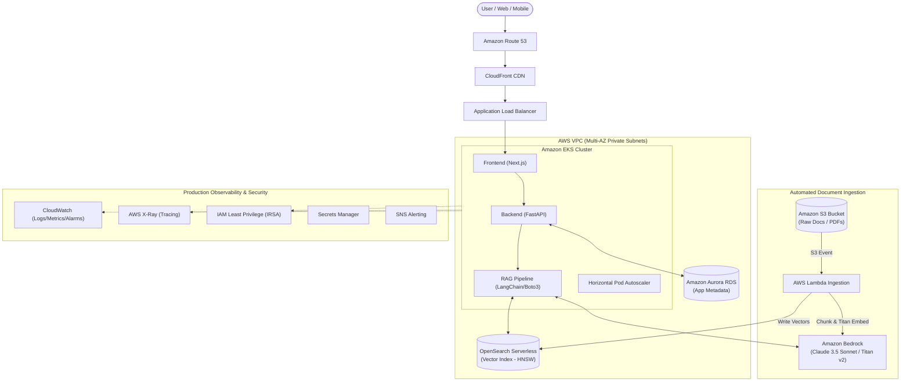

# ☁️🤖 AWS + GenAI – Complete Production Architecture 🚀

Build, deploy, scale, and monitor production-ready Generative AI applications on AWS using **Amazon Bedrock**, **EKS**, **Lambda**, **S3**, **RAG**, **OpenSearch Serverless**, and **CloudWatch**.

---

## 🏗️ Architecture Overview



---

## 📁 Repository Structure

```
aws-genai-app/
├── .github/workflows/ci-cd.yml      # GitHub Actions CI/CD (Trivy, ECR, Helm)
├── infra/terraform/                 # Terraform Infrastructure as Code
│   ├── main.tf                      # Root module orchestrating all resources
│   ├── providers.tf                 # AWS, Kubernetes, Helm providers & remote state
│   ├── variables.tf                 # Global environment variables
│   ├── outputs.tf                   # Endpoints and ARNs
│   └── modules/                     # VPC, EKS, Bedrock, OpenSearch, S3, Lambda
├── helm/genai-app/                  # Kubernetes Helm Charts
│   ├── Chart.yaml                   # Chart metadata
│   ├── values.yaml                  # Production configs, IRSA, resource limits
│   └── templates/                   # Deployments, Services, Ingress, HPA
├── src/
│   ├── backend/                     # FastAPI backend application
│   │   ├── app/
│   │   │   ├── main.py              # Application entrypoint & probes
│   │   │   ├── routes.py            # Chat & ingestion REST endpoints
│   │   │   ├── rag_pipeline.py      # Bedrock + OpenSearch RAG logic
│   │   │   ├── bedrock_client.py    # Claude 3.5 Sonnet & Titan Embeddings
│   │   │   ├── vector_store.py      # OpenSearch Serverless k-NN & Hybrid search
│   │   │   └── utils.py             # Recursive text chunking
│   │   ├── Dockerfile               # Multi-stage hardened container image
│   │   └── requirements.txt         # Python dependencies
│   ├── frontend/                    # Next.js UI
│   │   ├── app/page.tsx             # Interactive RAG chat UI with citations
│   │   ├── Dockerfile               # Production Next.js standalone container
│   │   └── package.json
│   └── lambda/                      # S3 Document Ingestion Lambda
│       ├── ingestion_handler.py     # PDF parsing, chunking, Titan embeddings
│       └── requirements.txt
├── data/documents/                  # Source documents for knowledge base
├── tests/                           # Pytest unit & integration test suite
├── scripts/                         # deploy.sh and ingest_data.sh automation
├── docker-compose.yml               # Local stack testing configuration
└── README.md
```

---

## ⚡ Quick Start

### 1. Local Testing with Docker Compose
```bash
docker-compose up --build
```
- Frontend UI: `http://localhost:3000`
- FastAPI Docs: `http://localhost:8000/docs`

### 2. Infrastructure Deployment (AWS)
```bash
cd infra/terraform
terraform init
terraform apply -var="environment=prod"
```

### 3. Deploy Kubernetes App (Helm)
```bash
aws eks update-kubeconfig --name genai-eks-cluster --region us-east-1
helm upgrade --install genai-app helm/genai-app -n genai --create-namespace
```
